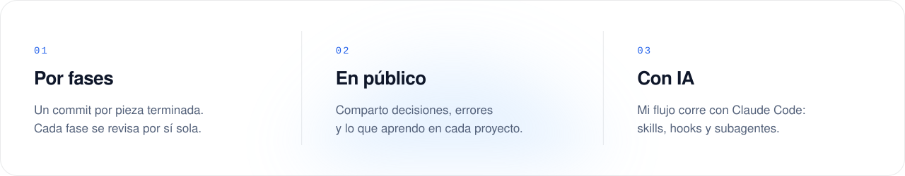

<!-- Los SVG de /assets se generan con scripts/build_readme_assets.py. No los edites a mano. -->

<picture>
  <source media="(prefers-color-scheme: dark)" srcset="./assets/hero-dark.svg">
  
</picture>

  <a href="https://gabrielnuvix-web.vercel.app"><picture><source media="(prefers-color-scheme: dark)" srcset="./assets/btn-portafolio-dark.svg"></picture></a>
  <a href="https://linkedin.com/in/gabriel-mf25"><picture><source media="(prefers-color-scheme: dark)" srcset="./assets/btn-linkedin-dark.svg"></picture></a>
  <a href="mailto:gabrielmayorga1546@gmail.com"><picture><source media="(prefers-color-scheme: dark)" srcset="./assets/btn-correo-dark.svg"></picture></a>
  <a href="https://youtube.com/@gabrielmayorga5170"><picture><source media="(prefers-color-scheme: dark)" srcset="./assets/btn-youtube-dark.svg"></picture></a>

  Ingeniero de sistemas en Nicaragua. Construyo software full-stack con Next.js y TypeScript, 
  automatizo procesos con IA y comparto el proceso completo: decisiones, errores y aprendizajes.

 

## Proyectos

  <a href="https://github.com/GabrielMayorga/dental-day-web"><picture><source media="(prefers-color-scheme: dark)" srcset="./assets/proyecto-dental-dark.svg"></picture></a>
  <a href="https://gabrielnuvix-web.vercel.app"><picture><source media="(prefers-color-scheme: dark)" srcset="./assets/proyecto-portafolio-dark.svg"></picture></a>
  <picture><source media="(prefers-color-scheme: dark)" srcset="./assets/proyecto-lotify-dark.svg"></picture>
  <picture><source media="(prefers-color-scheme: dark)" srcset="./assets/proyecto-pdf-dark.svg"></picture>

También construyendo: un constructor de CV con plantillas y exportación a PDF.

## Stack

  <picture>
    <source media="(prefers-color-scheme: dark)" srcset="https://skillicons.dev/icons?i=ts,js,nextjs,tailwind,vercel,linux,git,github&theme=dark">
    
  </picture>

Además: SQL, PowerShell y Claude Code (skills, hooks y subagentes) sobre WSL2.

## Cómo trabajo

<picture>
  <source media="(prefers-color-scheme: dark)" srcset="./assets/principios-dark.svg">
  
</picture>

**Nuvix** es mi consultoría tecnológica en arranque: mantenimiento de hardware, desarrollo web y automatización con IA para negocios en Nicaragua.

## Actividad

<picture>
  <source media="(prefers-color-scheme: dark)" srcset="https://raw.githubusercontent.com/GabrielMayorga/GabrielMayorga/output/snake-dark.svg">
  
</picture>

## Formación

9 cursos completados en [Platzi](https://platzi.com/p/gabrielmayorga1546646/): Linux, Git y GitHub, HTML, Prompt Engineering, oratoria y gestión del tiempo.

 

{GM} · Construyendo en público desde Nicaragua

