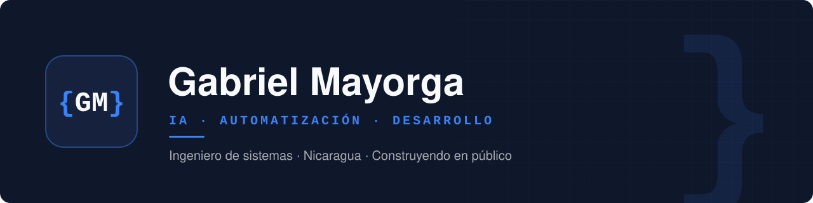

  

  Ingeniero de sistemas en Nicaragua. Construyo software full-stack y automatizaciones con IA, y documento el proceso en público.

  
  
  
  

## { construyendo ahora }

| Proyecto | Qué es | Estado | Enlaces |
|---|---|---|---|
| **Dental Cloud System** | SaaS de gestión para clínicas dentales | Construyendo · demo disponible | [web](https://github.com/GabrielMayorga/dental-day-web) · [api](https://github.com/GabrielMayorga/dental-day-api) · [demo](URL_DEMO) |
| **Portafolio** | Sitio personal en Next.js 16, TypeScript estricto y Tailwind v4 | En producción | [sitio](https://gabrielmayorga-web.vercel.app) |
| **Lotify** | SaaS white-label para venta de lotes residenciales | Construyendo | — |

También construyendo: un constructor de CV y un conversor de PDF.

## { stack }

**Lenguajes**

**Web**

**Infraestructura y entorno**

## { cómo trabajo }

- Por fases, con un commit por pieza terminada.
- Construyo en público: decisiones, errores y lo que aprendo en cada proyecto.
- **Nuvix** es mi consultoría tecnológica en arranque: mantenimiento de hardware, desarrollo web y automatización con IA para negocios en Nicaragua.

## { formación }

9 cursos completados en [Platzi](https://platzi.com/p/gabrielmayorga1546646/): Linux, Git y GitHub, HTML, Prompt Engineering, oratoria y gestión del tiempo.

---

{GM} · Construyendo en público desde Nicaragua
